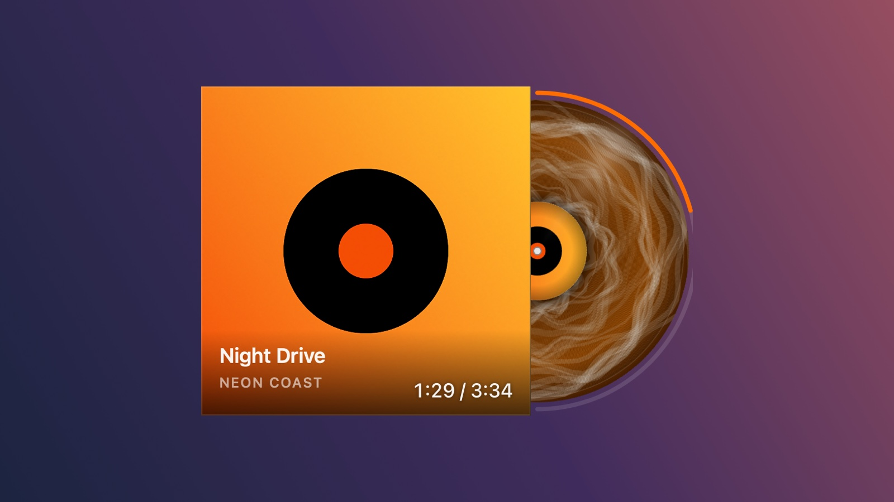
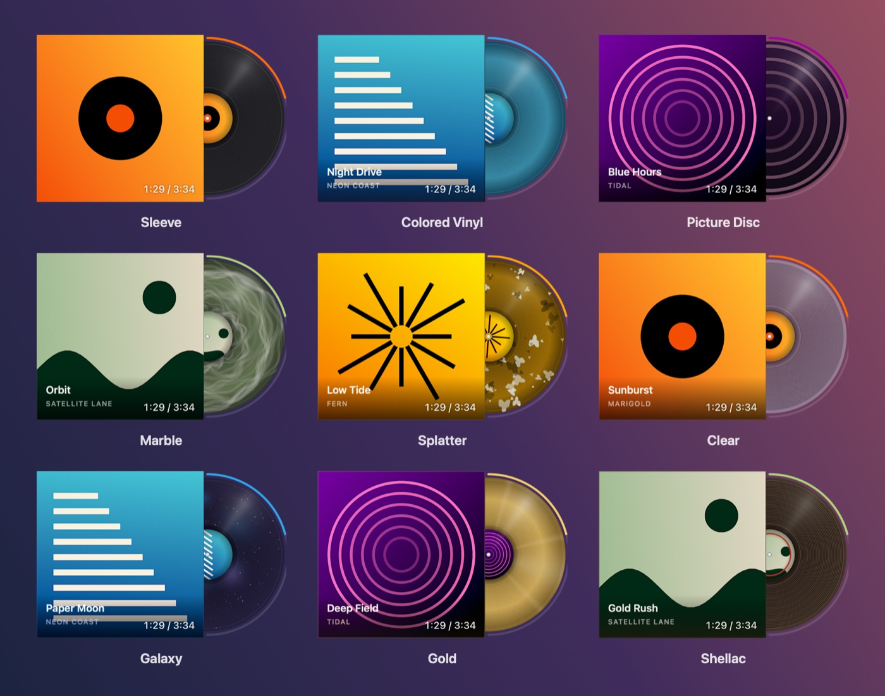

# Vinyl

**A record sleeve for your macOS desktop.** Vinyl shows the cover of whatever is playing, and the record slides out from behind it and spins while the music plays. Pause the music and the record slides back in.

It works with any source macOS shows under Now Playing: Apple Music, Spotify, YouTube and Yandex Music in the browser, VLC, IINA and others.

[Русская версия](README.ru.md)



## Features

- **The record reacts to playback.** It slides out when music starts, spins up and down smoothly, and slides back in on pause. When the track changes, the old record goes back into its sleeve and the new sleeve drops into place.
- **Nine pressings.** Each theme is a separate pressing technique with its own drawing: coloured wax tinted from the cover, marbling, splatter, a picture disc, a see-through record, galaxy, gold, 78 rpm shellac.
- **Progress ring and track time.** Drag along the ring to seek. Grab the record itself to scratch it by hand: one turn of the record is 1.8 seconds of audio, just like a real 33⅓.
- **Crate.** The latest covers stand in a separate window as a shelf, a fan or a row of spines. Click a cover to copy «Artist — Title».
- **Equalizer.** L/R meters or a spectrum driven by the real system audio, in five styles: hi-fi, minimal, bar, dots, needle.
- **Sounds.** Needle drop, crackle while playing, hand scratch, record swap, stop. A built-in set is included, and you can add your own (see [Sounds](#sounds)).
- **Listening stats.** Today, this week, all time, top tracks and artists.
- **Everyday details.** Launch at login, always on top, hide when nothing is playing, four slide directions, opacity, sizes, Russian and English interface.



## Requirements

- macOS 14 Sonoma or newer, Apple Silicon or Intel.
- The equalizer needs macOS 14.4 or newer.

## Installation

1. Download `Vinyl-<version>.dmg` from [Releases](https://github.com/DanilKhmyrov/Vinyl-Player/releases).
2. Open it and drag **Vinyl** into **Applications**.
3. Launch Vinyl. The app isn't notarized by Apple, so the first launch is blocked. Open **System Settings → Privacy & Security**, scroll down and click **Open Anyway** next to the Vinyl message.

Vinyl lives in the menu bar and doesn't show a Dock icon.

### Permissions

On first launch of the equalizer, macOS asks for permission to capture system audio. Vinyl only reads the signal level to drive the meters. Nothing is recorded or stored. Without this permission everything else works; the meters just stay dim.

## Controls

| Action | What it does |
|---|---|
| Click | Play / pause |
| Click the label | Bring the player app to the front |
| Drag the sleeve | Move the widget |
| Drag along the progress ring | Seek |
| Drag the record | Scratch by hand |
| Horizontal scroll | Next / previous track |
| Right click or the menu bar icon | Menu |

What a drag does depends on where it starts: the ring seeks, the exposed part of the record scratches, the sleeve moves the window.

The menu bar menu shows the current track, transport buttons, recent tracks, **Bring everything back** (returns every Vinyl window to the bottom-left corner of the screen), **Settings…** and **Quit**. Everything configurable lives in the settings window.

## Sounds

Every sound slot is a folder:

```
~/Library/Application Support/Vinyl/sounds/<slot>/
```

| Folder | When it plays |
|---|---|
| `start` | Music starts: the needle drops |
| `stop` | Music pauses |
| `swap` | The track changes |
| `ambience` | Loop, crackle while the music plays |
| `scratch` | Loop, while you turn the record by hand |

Each folder already holds **Vinyl**, the built-in sound. Hand scratch and record swap are on by default; turn on the rest in **Settings → Sounds**.

To use your own sound, drop a `.wav`, `.aiff`, `.caf`, `.m4a` or `.mp3` file into a slot folder: it shows up in **Settings → Sounds** under its file name. The quickest way there is the **Open the sounds folder…** button.

Tips:
- For one-shot sounds, trim the silence at both ends, otherwise they click.
- Loops (scratch, crackle) should join seamlessly: crossfade the tail into the head.

## Good to know

- **Cover quality depends on the player.** Browsers hand macOS a 150 px thumbnail at most, so Vinyl upscales and cleans it up. Apple Music and Spotify provide full-size covers.
- **There's no track queue.** macOS doesn't expose the upcoming tracks of a browser player. Vinyl records the tracks it has seen itself, so the crate and **Recent** only go backwards.
- **Now Playing uses a private macOS framework.** Since macOS 15.4, `MediaRemote` only answers Apple-signed processes, so Vinyl reads it through a small helper library hosted by the system `/usr/bin/perl`. A future macOS update may break this.

## Building from source

Requires Xcode 16 or newer (Swift 6 toolchain).

```bash
git clone https://github.com/DanilKhmyrov/Vinyl-Player.git
cd Vinyl-Player
./build_app.sh
open Vinyl.app
```

`./build_dmg.sh` builds a universal (arm64 + x86_64) release and packs it into `dist/Vinyl-<version>.dmg`. The version comes from the `VERSION` file.

The app icon and the built-in sounds are generated by code, so the repository contains no third-party assets:

- `Tools/make-icon.swift` renders every icon size, `iconutil` assembles `Vinyl.icns`.
- `Tools/make-sounds.swift` synthesises the sounds in `Resources/Sounds/`:

  ```bash
  swiftc -O -o /tmp/make-sounds Tools/make-sounds.swift && /tmp/make-sounds Resources/Sounds
  ```

## License

[MIT](LICENSE) © 2026 Danil Khmyrov
