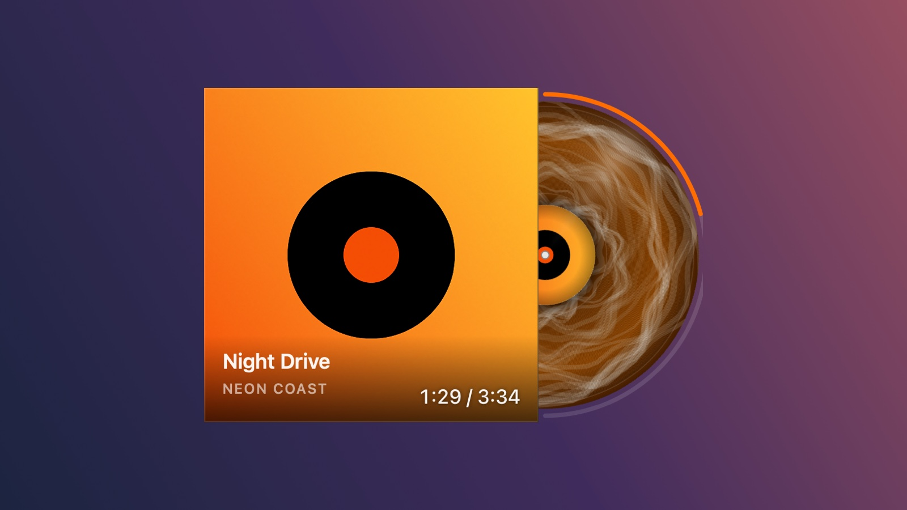
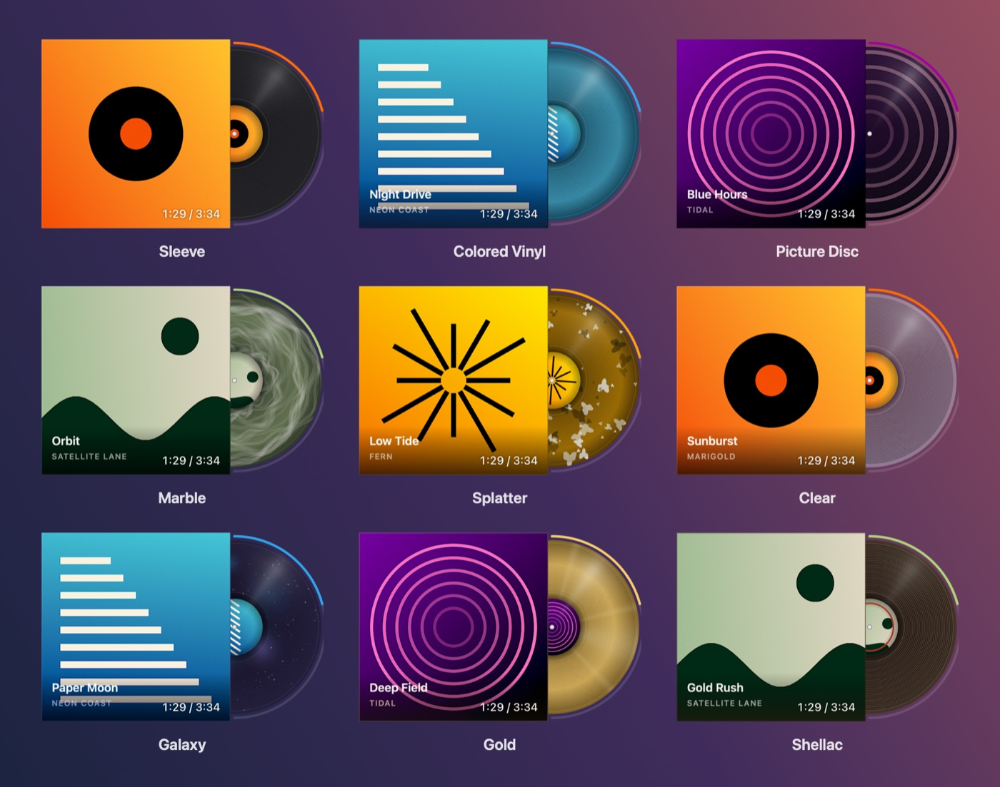

# Vinyl

**Конверт с пластинкой на рабочем столе macOS.** Vinyl показывает обложку того, что сейчас играет. Пока идёт музыка, из-под конверта выезжает пластинка и крутится; на паузе она уезжает обратно.

Работает с любым источником, который macOS показывает в «Сейчас играет»: Apple Music, Spotify, YouTube и Яндекс Музыка в браузере, VLC, IINA и другие.

[English version](README.md)



## Возможности

- **Пластинка живёт вместе с музыкой.** Выезжает на старте, плавно разгоняется и тормозит, уезжает на паузе. При смене трека старая пластинка прячется в конверт, а новый конверт опускается на её место.
- **Девять прессовок.** Каждая тема — отдельная техника со своей отрисовкой: цветной воск по цвету обложки, мрамор, брызги, пикчер-диск, прозрачный винил, галактика, золото, шеллак на 78 оборотов.
- **Дуга прогресса и время трека.** Потяни по дуге — перемотка. Возьмись за саму пластинку — крутишь её рукой: один оборот равен 1,8 секунды звука, как у настоящей пластинки на 33⅓.
- **Картотека.** Последние обложки стоят в отдельном окне: полкой, веером или корешками. Клик по обложке копирует «Артист — Название».
- **Эквалайзер.** Столбики L/R или спектр от настоящего звука системы, пять стилей: хай-фай, минимал, полоса, точки, стрелка.
- **Звуки.** Опускание иглы, шум при игре, прокрутка рукой, смена пластинки, остановка. Встроенный набор есть в комплекте, можно добавить свои (см. [Звуки](#звуки)).
- **Статистика.** Сегодня, за неделю, за всё время, любимые треки и исполнители.
- **Мелочи.** Запуск при входе, поверх всех окон, прятать, когда ничего не играет, четыре направления выезда, прозрачность, размеры, русский и английский интерфейс.



## Требования

- macOS 14 Sonoma или новее, Apple Silicon или Intel.
- Эквалайзеру нужна macOS 14.4 или новее.

## Установка

1. Скачай `Vinyl-<версия>.dmg` со страницы [Releases](https://github.com/DanilKhmyrov/Vinyl-Player/releases).
2. Открой его и перетащи **Vinyl** в **Программы**.
3. Запусти Vinyl. Приложение не нотаризовано Apple, поэтому первый запуск macOS заблокирует. Открой **Системные настройки → Конфиденциальность и безопасность**, пролистай вниз и нажми **Всё равно открыть** рядом с сообщением о Vinyl.

Vinyl живёт в строке меню, значка в Dock у него нет.

### Разрешения

Когда включается эквалайзер, macOS спрашивает разрешение на захват системного звука. Vinyl читает только уровень сигнала для столбиков, ничего не записывает и не сохраняет. Без разрешения всё остальное работает, столбики просто остаются тусклыми.

## Управление

| Действие | Что делает |
|---|---|
| Клик | Пауза / воспроизведение |
| Клик по этикетке | Вынести плеер на передний план |
| Перетаскивание за конверт | Переместить виджет |
| Перетаскивание по дуге прогресса | Перемотка |
| Перетаскивание за пластинку | Крутить рукой |
| Горизонтальный скролл | Следующий / предыдущий трек |
| Правый клик или значок в строке меню | Меню |

Что делает перетаскивание, зависит от того, где оно началось: дуга — перемотка, открытая часть пластинки — прокрутка рукой, конверт — перенос окна.

В меню строки состояния: что играет, кнопки перемотки, недавние треки, **Собрать всё на место** (возвращает все окна Vinyl в левый нижний угол экрана), **Настройки…** и **Выйти**. Всё настраиваемое — в окне настроек.

## Звуки

Каждый звук — это папка:

```
~/Library/Application Support/Vinyl/sounds/<слот>/
```

| Папка | Когда звучит |
|---|---|
| `start` | Музыка пошла: опускается игла |
| `stop` | Музыка на паузе |
| `swap` | Смена трека |
| `ambience` | Петля, шум пластинки, пока играет музыка |
| `scratch` | Петля, пока крутишь пластинку рукой |

В каждой папке уже лежит **Vinyl** — встроенный звук. Прокрутка рукой и смена пластинки включены сразу, остальные включаются в **Настройки → Звуки**.

Чтобы поставить свой звук, положи в папку слота файл `.wav`, `.aiff`, `.caf`, `.m4a` или `.mp3` — он появится в **Настройки → Звуки** под своим именем. Быстрее всего туда попасть кнопкой **Открыть папку со звуками…**.

Советы:
- У одиночных звуков обрежь тишину по краям, иначе будут щелчки.
- Петли (прокрутка, шум) должны стыковаться без шва: подмешай хвост в начало кроссфейдом.

## Полезно знать

- **Качество обложки зависит от плеера.** Браузеры отдают системе превью не больше 150 px, поэтому Vinyl увеличивает и чистит его. Apple Music и Spotify отдают полноразмерные обложки.
- **Очереди треков нет.** macOS не отдаёт следующие треки браузерного плеера. Vinyl запоминает треки, которые видел сам, поэтому картотека и «Недавние» идут только назад.
- **«Сейчас играет» берётся через приватный фреймворк macOS.** Начиная с macOS 15.4 `MediaRemote` отвечает только процессам, подписанным Apple, поэтому Vinyl читает его через маленькую библиотеку, которую загружает системный `/usr/bin/perl`. Будущее обновление macOS может это сломать.

## Сборка из исходников

Нужен Xcode 16 или новее (Swift 6).

```bash
git clone https://github.com/DanilKhmyrov/Vinyl-Player.git
cd Vinyl-Player
./build_app.sh
open Vinyl.app
```

`./build_dmg.sh` собирает универсальную (arm64 + x86_64) релизную версию и упаковывает её в `dist/Vinyl-<версия>.dmg`. Версия берётся из файла `VERSION`.

Иконка и встроенные звуки генерируются кодом, поэтому чужих ассетов в репозитории нет:

- `Tools/make-icon.swift` отрисовывает иконку во всех размерах, `iconutil` собирает `Vinyl.icns`.
- `Tools/make-sounds.swift` синтезирует звуки в `Resources/Sounds/`:

  ```bash
  swiftc -O -o /tmp/make-sounds Tools/make-sounds.swift && /tmp/make-sounds Resources/Sounds
  ```

## Лицензия

[MIT](LICENSE) © 2026 Danil Khmyrov
